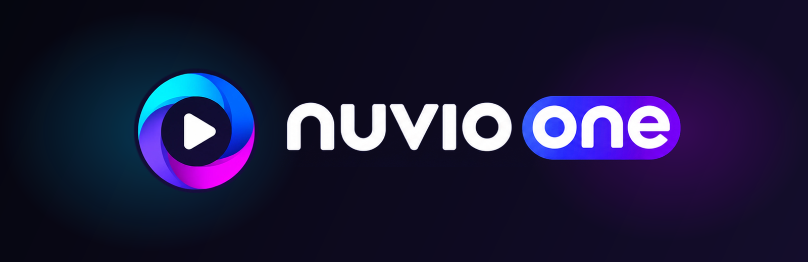

<div align="center">



# Nuvio One M

**Movies and shows, music, live TV, sports, OneTube and WireGuard VPN in one app for Android phones and tablets.**

[](https://github.com/zoga2o3-ops/Nuvio-One-M/releases)
[](https://github.com/zoga2o3-ops/Nuvio-One-M/releases)
[](LICENSE)


[What is it](#what-is-it) · [What you get](#what-you-get) · [Install](#install) · [Getting started](#getting-started) · [FAQ](#faq) · [Credits](#credits)

</div>

> **Beta software.** Expect bugs, rough edges and changes between releases. Please report what you find.
>
> This app **does not provide any content, playlists or streams.** You bring your own sources.

> **New in 1.1.0:** a refreshed Live TV interface with Now & Next, SMB recordings, optional YouTube Continue Watching, built-in WireGuard VPN, Plex and Silo servers, and more.

## What is it

Nuvio One M is a phone and tablet app built on **Nuvio 1.1.0**, with five parts in one app:

1. **[Nuvio](https://github.com/NuvioMedia/NuvioMobile):** the home screen, addons, collections, Trakt and Simkl, your Nuvio account, downloads and Nuvio's player.
2. **Music:** Home, Explore, Library, Local, Search, Party and integrations, with background playback.
3. **Live TV:** Live TV, Sports, Calendar, recordings and On Demand, from [NuvioPlusIPTV](https://github.com/homelessbrian/NuvioPlusIPTV) by homelessbrian, brought over to the phone.
4. **OneTube:** a YouTube section of its own, played in the same player.
5. **VPN:** built-in WireGuard protection for playback, with profiles stored on this device.

It is the phone companion to the **[Nuvio + IPTV + 1Tube TV app](https://github.com/zoga2o3-ops/NuvioPlusIPTV-1T)**, and the two share your Live TV setup through Google Drive. It has its own package name, so it installs next to the official Nuvio app.

## What you get

### Nuvio core
- Home, addons, collections, Trakt and Simkl, your Nuvio account and Nuvio's player.
- A redesigned Downloads screen, custom posters and artwork.
- Plex and Silo media servers, with shared sign-in screens.
- Casting from the shared player.
- Home hero sources and catalog controls, including the option to keep the home screen focused.

### Music
- Home, Explore, Library, Local and Search, with background playback that keeps going when you leave the app.
- Queue, lyrics, Up Next, likes, playlists, radio and downloads.
- WebDAV and Navidrome servers, local and USB music, plus Google Drive uploads.
- Party mode with a guest QR, Last.fm and Spotify integrations.
- Layouts for phone portrait, phone landscape and tablet.

### Live TV
- M3U links, Xtream logins and Stalker portals, XMLTV guides, several at once, each one editable and switchable.
- The new 1.1.0 interface: a **Now & Next** hero, a **Playlists** picker, a **Groups** picker, icon page tabs, an adaptive header on phones, roomier guide rows and wider controls on large screens.
- List or grid channels, a guide grid, your own groups, copy channels between groups, rename, renumber, change logos, hide, favorites and recents.
- Search by channel, or by programme to see what is on now or soon.
- Each profile can choose which playlists it shows. Personal choices are combined across playlists and deleted playlists are cleaned up.
- Playlists that include movie and episode entries feed On Demand too.
- Catch-up replay (where your provider supports it), a pause and rewind buffer, a backup channel if one drops, captions, passthrough audio and frame-rate matching.
- Multiview, an in-player channel list, quality badges, reminders, a sleep timer and a parental PIN for groups.
- A Live TV row and new-episode cards on Home, with their own layout settings.
- Playlist repair, so provider streams with small faults still play.

### Recording
- Record now, schedule from the guide, record a whole series, keep the last N, and resume where you left off.
- Record to this device or to an **SMB share**.
- New recordings are mirrored to the share while they are being made; playback can come straight from the share after the local media is removed.
- Deleting a recording removes its SMB copy too.
- SMB credentials are encrypted on the device, with a connection test in settings.

### On Demand
- Your provider's movies and series as rows, with search, genres, sorting, several versions of a title and an episode picker.
- Category dropdown and compact search/sort controls.
- Continue watching on Home, show or hide, rename, reorder and lock groups, and Fix poster.
- "Watch On Demand" appears in Nuvio's own stream list.

### Sports
- Scores by day and league, My Teams, league tables, game details, which of your channels carry a game, and a video window on the page.
- Game tabs, a live strip, team colours and centred tabs.
- One-tap sport chips, with team colours in tables and the best records first.
- Picked channels stay linked when a playlist renames them.
- Official highlights, recaps and replays.
- Record a game, reminders for the teams you follow, score alerts and an optional switch to the game when it starts.

### Calendar
- Upcoming, recently aired, airing today and Following, movie release dates for your Library, "On my TV" (where your channels carry a show), a bell on a show's page, and a New episodes row on Home.

### OneTube
- A YouTube tab that needs no account: browse, search, captions, chat and SponsorBlock.
- Sound tracks start on the original language, with storyboard seek previews.
- An optional **Continue Watching on Home** row for videos you started in OneTube. Progress is local, the row is off by default, and videos resume where you left off.

### VPN
- Built-in **WireGuard** protection for streaming playback.
- Four modes: Off, HTTP streams only, HTTP + HTTPS streams, and Full app.
- Profiles are encrypted on this device and stay local; import from a file or a QR code.
- A playback gate, connection status, traffic counters and the VPN IP.
- WireGuard only. Profiles are not synced to other devices.

### Casting
- Google Cast from the shared player: movies, series, live channels and YouTube.

### Everywhere
- Search shows matching channels, shows on now and On Demand titles next to Nuvio's results, and Home gets Live TV, New episodes and On Demand rows.
- Simkl signs in with a code. Signing out of Nuvio also clears Live TV and the Drive link.
- **Google Drive sync:** back up and restore your Live TV setup between your phone and your TV, with your own Drive.
- Settings for Music, OneTube and Live TV can be shown or hidden as sections; OneTube and Live TV use the grey card styling.
- New screens and messages are translated across the app.

## Known rough edges

- Beta software: not every phone and tablet has been tried, so other devices may behave differently.
- Casting has only been tried with a limited set of Cast devices. Some streams cannot be cast, such as the phone's own P2P server or local files.
- Recording, "On my TV", auto-switch to a game and protected (DRM) channels have had the least testing.
- Stalker portals have only been tried against a test portal. Movies and series, catch-up and portals that ask for a login are not supported, and recording, the pause buffer and casting are the least tested with them.
- The VPN is new. HTTP and HTTP + HTTPS playback modes are the most tested; Full app mode is available but less tested. It is WireGuard only, and profiles stay on the device.
- SMB recording needs a reachable SMB share. Credentials are encrypted on the device.

## Install

Download the APK for your phone from the [Releases](https://github.com/zoga2o3-ops/Nuvio-One-M/releases) page. Most phones need `arm64-v8a`. After that the app updates itself from **Settings → About**.

## Getting started

1. Open the app and sign in with your Nuvio account, or continue without one.
2. Go to **Live TV → Sources** and add an M3U link, Xtream login or Stalker portal, plus a guide if you have one.
3. The OneTube tab works straight away. To cast, press the Cast button in the player.
4. To use the VPN, open **Profile → VPN**, import a WireGuard `.conf` file, pick the profile, and choose a protection mode.

## FAQ

<details>
<summary>Does it come with channels, movies or videos?</summary>

No. It plays what you add yourself: your own playlists, guides, Xtream logins and addons, plus YouTube.
</details>

<details>
<summary>Will it replace my Nuvio app?</summary>

No. It has its own package name and installs next to it.
</details>

<details>
<summary>What does Google Drive sync store?</summary>

Your Live TV setup, in a file in your own Google Drive.
</details>

<details>
<summary>Do VPN profiles sync to my other devices?</summary>

No. They are encrypted on this device and never leave it. Import the profile again on each device.
</details>

<details>
<summary>Can I record Live TV to an SMB share?</summary>

Yes. Open **Live TV → Settings → Recordings**, turn on **Save recordings to SMB**, and enter the share details. The app mirrors recordings while they are made and can play them back from the share.
</details>

<details>
<summary>Does YouTube Continue Watching need a YouTube account?</summary>

No. It uses local progress from videos you start in OneTube. Turn on **Show on Home** in OneTube settings to add the row.
</details>

<details>
<summary>Why does the Home spotlight show a live TV channel?</summary>

The spotlight is the Home hero, not the Live TV row. It uses the hero sources selected under **Settings → Layout → Home screen → Hero sources**. If an IPTV/Live TV catalog is enabled there, turn it off. The Live TV row toggle only controls the channel row on Home.
</details>

<details>
<summary>Does the VPN protect other apps?</summary>

The two playback modes protect the player's HTTP and HTTPS traffic. Full app mode protects traffic from Nuvio itself; other apps are unaffected.
</details>

## Credits

- **Nuvio** by the NuvioMedia team, which this app is built on.
- **NuvioMobile-Enhanced** by [luqmanfadlli](https://github.com/luqmanfadlli/NuvioMobile-Enhanced) (GPLv3): the customizable player, night mode, pinned streams, extra trackers and many other improvements in this app come from their fork.
- **NuvioPlusIPTV** by homelessbrian: the Live TV guide, Sports, recordings and On Demand.
- **BitChord** by [kushagrasinghx](https://github.com/kushagrasinghx/BitChord) (GPLv3): the Music section and its YouTube Music engine, ported to this app.
- **SmartTube / MediaServiceCore** by Yurii Liskov (MIT licence): the YouTube engine.
- **SponsorBlock** by Ajay Ramachandran and its community.
- **WireGuard** by Jason A. Donenfeld and contributors: the VPN tunnel and protocol.
- **jcifs-ng** by AgNO3 (LGPL 2.1): the SMB client used for network recordings.
- Sports data from ESPN and FotMob, using TheSportsDB-compatible files; wrestling schedule from WWE.com, All Elite Wrestling and TNA; boxing schedule from Box.live. Guide design inspired by TiviMate.
- This product uses the TMDB API but is not endorsed or certified by TMDB.

This is an unofficial fork. It is **not affiliated with or endorsed by NuvioMedia, NuvioMobile-Enhanced, NuvioPlusIPTV, BitChord, SmartTube, SponsorBlock, TiviMate, Google, YouTube, Plex or Silo.**

## Legal

This app is a client-side player. It does not host, store or distribute any media, and it ships with no channels, playlists or content sources. Only use sources you own or are authorized to access. Nuvio's [legal and DMCA information](https://github.com/NuvioMedia/NuvioTV#legal--dmca) applies here too.

Licensed under the **GNU General Public License v3.0**, like upstream Nuvio. See [LICENSE](LICENSE). If you share a build, share its source too.

## Building

You need JDK 17 or newer and the Android SDK.

```bash
git clone --recurse-submodules https://github.com/zoga2o3-ops/Nuvio-One-M.git
cd Nuvio-One-M
./gradlew :androidApp:assembleFullDebug
```

The VPN module also builds a Go tunnel. CI installs Go and the Android NDK; locally, set `NUVIO_GO` to a Go 1.27+ binary and use Android NDK 29 or newer.

<details>
<summary><code>local.properties</code> keys (optional, not committed)</summary>

Features that need a key stay switched off without one.

| Key | Used for |
| --- | --- |
| `TMDB_API_KEY` | Movie dates in the Calendar, title logos, Fix poster |
| `SIMKL_CLIENT_ID`, `SIMKL_APP_NAME` | Simkl sign-in |
| `TRAKT_CLIENT_ID`, `TRAKT_CLIENT_SECRET`, `TRAKT_REDIRECT_URI` | Trakt sign-in |
| `GOOGLE_DRIVE_CLIENT_ID`, `GOOGLE_DRIVE_CLIENT_SECRET` | Live TV Drive sync (a Google OAuth client of type "TVs and limited input devices") |
| `NUVIO_SUPABASE_URL`, `NUVIO_SUPABASE_ANON_KEY` | Nuvio account sync |
| `NUVIO_RELEASE_STORE_FILE`, `NUVIO_RELEASE_STORE_PASSWORD`, `NUVIO_RELEASE_KEY_ALIAS`, `NUVIO_RELEASE_KEY_PASSWORD` | Signing release builds |
</details>

<details>
<summary>Making a release</summary>

```powershell
.\scripts\release-mobile.ps1 -Version 1.1.0-beta1 -Build 160
```

builds the signed APKs into `build\releases`. Add `-Publish -NotesFile <file>` to put them on GitHub. The comments in the script explain the rules the updater follows. Keep your signing key safe: without it installed copies cannot be updated.
</details>
